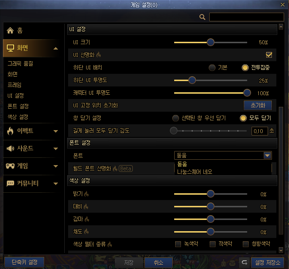

# 던삐삐

현재 속해있는 파티원, 공대원의 정보를 게임 화면에서 가져와 확인할 수 있는 Windows 앱입니다.

## 내려받기

[dfragon.com](https://dfragon.com)이나 [최신 Release](https://github.com/dungeon-and-dragon/dfragon/releases/latest)에서 `DFragon-<버전>-x64-portable.exe`를 내려받습니다.

## 사용법

1. **Alt+R**이나 캡처 버튼을 누르면 닉네임을 읽고 검색합니다.
2. 파티라면, 왼쪽 상단에 파티 프레임이 존재해야 캡처를 진행합니다.
3. 공대라면, 공대창이 띄워진 상태여야 캡처를 진행합니다.
4. 직접 닉네임을 입력해 검색할 수 있습니다. 서버와 닉네임은 언제든 고쳐 다시 조회할 수 있습니다.

게임 설정의 **화면 > 폰트 설정**에서 폰트를 **돋움**으로 두어야 닉네임을 인식(OCR)할 수 있습니다.

## 앱이 보내는 정보

- **캐릭터 검색**: 서버와 닉네임을 API(`api.dfragon.com`)에 보내고, API가 [Neople 오픈 API](https://developers.neople.co.kr)에서 조회합니다.
- **새 버전 확인**: 앱의 첫 실행, 이후 6시간마다 GitHub Release 목록을 확인합니다.
- **사용 통계**: 보내지 않습니다. v1.0.0만 앱 실행, 캡처, 검색을 하면 Google Analytics 4에 무작위 ID, 세션 ID, 앱 버전, 파티인지 공대인지를 보내며, 다음 버전에서 지웠습니다. 닉네임, 서버, 캐릭터, 이미지, OCR 결과는 v1.0.0도 보내지 않습니다.

## 개발

pnpm workspace 모노레포입니다.

| 경로 | 내용 |
| --- | --- |
| [`apps/desktop`](apps/desktop/README.md) | Windows 앱(Electron) |
| [`apps/api`](apps/api/README.md) | Neople 오픈 API를 조회해 캐시하는 공개 캐릭터 API |
| [`apps/web`](apps/web/README.md) | 소개와 내려받기 사이트(dfragon.com) |
| [`packages/lib`](packages/lib/README.md) | API와 Desktop이 함께 쓰는 입력 규칙, 게임 UI 좌표, 픽셀 계산 |
| [`packages/ui`](packages/ui/README.md) | 디자인 토큰과 공용 컴포넌트 |
| [`packages/licenses`](packages/licenses/README.md) | 배포물에 넣는 오픈소스 고지 수집 |
| [`packages/models`](packages/models/README.md) | OCR 모델과 점수 엔진 submodule |

설치, 검증 명령과 작업 경계는 [AGENTS.md](AGENTS.md), 제품 계약과 결정 기록은 [문서 안내](docs/README.md)에서 시작합니다.

---

배포 앱에 포함된 오픈소스 고지의 위치는 [Desktop 안내의 Windows 배포 빌드](apps/desktop/README.md#windows-배포-빌드)에 있습니다.

